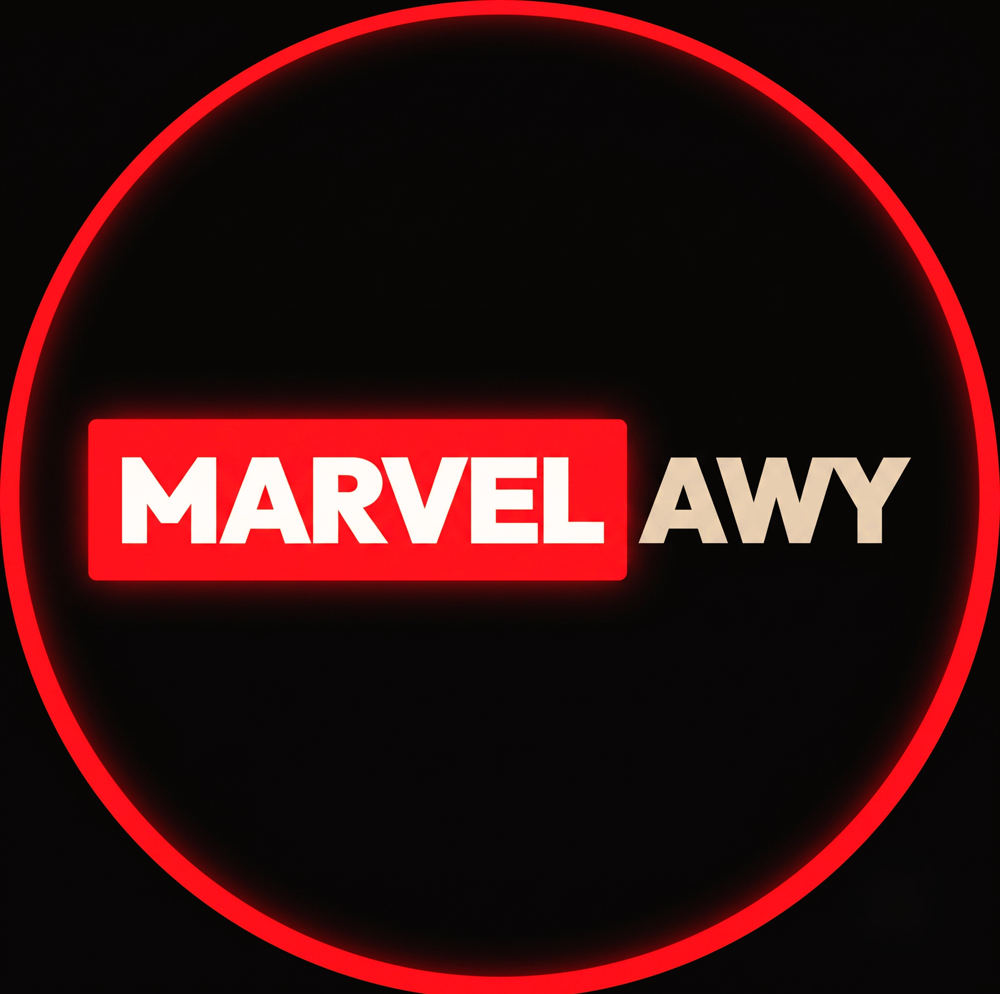
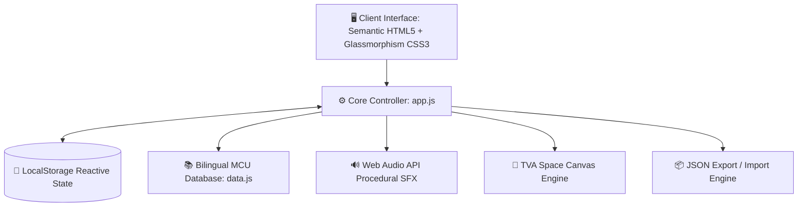
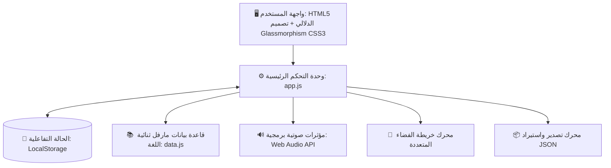

  

  # ⚡ MARVELAWY
  ### The Ultimate MCU Chronological Timeline & Multiverse Experience

  

    
    
    
    
    
  

  

    <a href="#-arabic-version--النسخة-العربية"><b>⬇️ الانتقال إلى النسخة العربية (Jump to Arabic Version)</b></a>
  

  

    <a href="#-live-demo">Live Demo</a> •
    <a href="#-project-overview">Overview</a> •
    <a href="#-key-features">Key Features</a> •
    <a href="#-system-architecture">Architecture</a> •
    <a href="#-easter-eggs--themes">Easter Eggs</a> •
    <a href="#-privacy--storage">Privacy</a> •
    <a href="#-disclaimer">Disclaimer</a>
  

---

# 🇬🇧 English Version

## 🚀 Live Demo

Experience the full interactive application directly in your browser:

  
  
<b>👉 <a href="https://marvelawy.vercel.app/" target="_blank">https://marvelawy.vercel.app/</a> 👈</b>

  
<i>Zero installation or sign-up required. Runs with 60/120fps fluid animations on desktop, tablet, and mobile.</i>

---

## 📖 Project Overview

The **Marvel Cinematic Universe (MCU)** spans over 40+ movies, series, and special presentations covering thousands of in-universe years—from the 1940s origins of Captain America during WWII to the intricate multiversal conflicts of the Multiverse Saga.

Watching these projects purely by theatrical release date fragments narrative continuity. **Marvelawy** is an interactive web platform designed to solve this challenge. It provides fans with:
1. An **in-universe chronological timeline** that traces events as they occurred within the story.
2. A **TVA-inspired 3D Multiverse Deep-Space Map** exploring parallel realities and alternate timelines.
3. A **gamified watch tracker with hero progression**, evolving your rank from S.H.I.E.L.D. Recruit to Cosmic Champion.
4. **100% native bilingual capability** (English & Arabic) with instant switching and custom RTL/LTR styling.

> [!NOTE]
> This repository is a dedicated **Showcase & Architectural Portfolio**. Source code is maintained privately, while this space documents the design system, features, and engineering paradigms behind the project.

---

## ✨ Key Features

### ⏳ 1. Sacred Chronological Timeline Engine
- **In-Story Chronology**: Sorts every movie, Disney+ series, and Special Presentation by its in-universe timeline (1942–2026+), rather than box-office release date.
- **Rich Media Cards**: Displays phase numbers, runtime, localized synopsis, and high-resolution posters.
- **Eras Quick Navigation**: One-click jumps between key eras (Origins & 20th Century, Early Avengers, Age of Ultron & Civil War, Infinity War & Endgame, and The Multiverse Saga).
- **Instant Search & Multi-Filters**: Real-time filtering by title (English or Arabic), media type (Movies/Series), and watch status (Watched/Unwatched).

### 🌌 2. Interactive Multiverse Map
- **Deep-Space Canvas**: A floating 3D celestial map powered by a Time Variance Authority (TVA) scanner design.
- **Parallel Realities**: Explore alternate branches outside Earth-616, including the Sony-Verse, Animated Timelines, and What If...? realities.
- **Universe-Specific Progress**: Independent progress bars and project lists for each parallel timeline.

### 🌐 3. Seamless Bilingual Engine (Arabic & English)
- **Instant Toggle**: Switch between Arabic and English with zero page reload.
- **Typography & RTL Optimization**: Powered by Google Fonts (**Outfit** & **Inter** for English LTR, **Cairo** & **Tajawal** for Arabic RTL).

### 📊 4. Gamified Progress & Hero Rank Progression
- **Interactive SVG Circular Gauge**: Displays real-time overall MCU completion percentage.
- **Granular Progress Trackers**: Dedicated meters for movies watched, series completed, and individual episodes tracked.
- **S.H.I.E.L.D. Hero Rank System**: Dynamic title promotions unlocking as you progress through the catalog.

### 🔨 5. Cosmic Easter Eggs & Dynamic Themes
- **Thor's Mjolnir Worthiness Test**: Interactive hammer challenge featuring shake physics, synthesized thunder SFX, and secret unlockable badges.
- **Deadpool 4th-Wall Banter**: An interactive Deadpool sticker at the bottom of the timeline delivering witty, fourth-wall-breaking commentary.
- **Atmospheric Visual Themes**: Real-time theme switcher between Sacred Timeline (Gold/Dark), Thor (Electric Blue), Loki (TVA Emerald), Venom (Symbiote Dark), and Spider-Man.

### 🔒 6. Zero-Knowledge Client-Side Privacy
- **Zero Tracking**: No account required, no cookies, and no third-party tracking databases.
- **Instant Local Storage Sync**: Watch history and settings automatically persist in browser `localStorage`.
- **JSON Data Portability**: One-click export and import of your entire profile progress to a lightweight `.json` backup file.

---

## 🛠️ System Architecture

Marvelawy was designed with a lean engineering philosophy: **Zero framework bloat, instant load times, and native browser APIs**.

### Technical Specifications

| Technology | Role | Advantage |
|---|---|---|
| **Vanilla JavaScript (ESNext)** | Application state, DOM reconciliation, event handling | Instant load time, zero framework overhead, memory efficiency |
| **Vite 5 Pipeline** | Build automation & asset bundling | Lightning-fast development server and optimized production assets |
| **Custom CSS3 Design System** | Glassmorphism, animations, 8pt responsive grid | Native GPU-accelerated styling with dynamic CSS Custom Properties |
| **Web Audio API** | Procedural sound generation | Sound effects generated in code without loading heavy audio files |
| **Bilingual JSON Schema** | Localized media repository | Modular, scalable structure for future MCU releases |

---

## ☕ Support & Author

- **Live Application**: [marvelawy.vercel.app](https://marvelawy.vercel.app/)
- **Author & Creator**: [AMOXMorad](https://github.com/AMOXMorad)
- **Showcase Repository**: [AMOXMorad/Marvelawy_Web](https://github.com/AMOXMorad/Marvelawy_Web)

**Support Options:**
- 🇪🇬 **Egypt (InstaPay)**: Transfer to IPA `mord20xx@instapay` or via [Direct Payment Link](https://ipn.eg/S/mord20xx/instapay/2Hc4BU)
- 🌍 **International (Ko-fi)**: Support via credit card or PayPal on [Ko-fi](https://ko-fi.com/R8Z4238F4K)

  
  

---

## 📜 Disclaimer

> [!IMPORTANT]
> **Marvelawy is an independent, non-commercial, fan-made educational and portfolio showcase project.**  
> All Marvel Cinematic Universe characters, imagery, titles, posters, and related properties are copyright and registered trademarks of **Marvel Studios © & The Walt Disney Company**. No copyright infringement is intended.

---
---

 

  

  # ⚡ النسخة العربية | Arabic Version
  # مارفلاوي (MARVELAWY)
  ### المنصة التفاعلية الشاملة للترتيب الزمني وخريطة الأكوان المتوازية لعالم مارفل السينمائي

  

    
    
    
  

  

    <a href="#-marvelawy"><b>⬆️ العودة إلى النسخة الإنجليزية (Back to Top / English Version)</b></a>
  

  

    <a href="#-رابط-المعاينة-الحية">المعاينة الحية</a> •
    <a href="#-نبذة-عن-المشروع">نبذة عن المشروع</a> •
    <a href="#-الميزات-والقدرات-الرئيسية">الميزات الرئيسية</a> •
    <a href="#-الهندسة-البرمجية-والبنية-التقنية">البنية التقنية</a> •
    <a href="#-الأسرار-والعناصر-التفاعلية">الأسرار التفاعلية</a> •
    <a href="#-الخصوصية-وحفظ-البيانات">الخصوصية</a> •
    <a href="#-إخلاء-المسؤولية-القانونية">إخلاء المسؤولية</a>
  

---

## 🚀 رابط المعاينة الحية

يمكنك تجربة المنصة بكامل خصائصها التفاعلية مباشرة عبر متصفحك:

  
  
<b>👉 <a href="https://marvelawy.vercel.app/" target="_blank">https://marvelawy.vercel.app/</a> 👈</b>

  
<i>لا تحتاج لتسجيل دخول أو تثبيت أي برامج — تعمل بسلاسة فائقة بمعدل 60/120 إطار في الثانية على الموبايل والتابلت والكمبيوتر.</i>

---

## 📖 نبذة عن المشروع

يمتد **عالم مارفل السينمائي (MCU)** عبر ما يزيد عن 40 عملاً سينمائياً وتلفزيونياً تتداخل أحداثها عبر آلاف السنين داخل القصة—بدءاً من الحرب العالمية الثانية وميلاد أول منتقم وحتى الصراعات المعقدة في عصر ملحمة الأكوان المتعددة (Multiverse Saga).

مشاهدة الأعمال حسب تاريخ الصدور في دور العرض غالباً ما يُربك المتابع ويشتت التسلسل المنطقي للأحداث. تم تطوير **مارفلاوي (Marvelawy)** ليكون الدليل التفاعلي الشامل، حيث يقدم:
1. **الترتيب الزمني الفعلي للأحداث داخل القصة (In-Universe Chronology)** من عام 1942 وحتى عام 2026+.
2. **خريطة فضائية ثلاثية الأبعاد للأكوان المتوازية (Multiverse Map)** مستوحاة من أجهزة منظمة تباين الوقت (TVA).
3. **نظام تتبع تفاعلي متقدم مع رتب أبطال متطورة** ترتقي معها رتبتك من مستجد في منظمة S.H.I.E.L.D. إلى بطل كوني أسطوري.
4. **دعم ثنائي اللغة كامل بنسبة 100% (عربي / إنجليزي)** مع تبديل فوري وسلس وتصميم مخصص للاتجاهين (RTL/LTR).

> [!NOTE]
> هذا المستودع مخصص كـ **معرض للمشروع (Showcase / Portfolio)** لتوثيق الهيكل البرمجي والقرارات التصميمية والميزات المبتكرة، بينما يُحتفظ بالكود المصدري بشكل خاص.

---

## ✨ الميزات والقدرات الرئيسية

### ⏳ 1. محرك الخط الزمني المقدس (Chronological Timeline)
- **ترتيب حسب تسلسل الأحداث**: تصنيف كل فيلم ومسلسل وعرض خاص بناءً على الزمن الفعلي لوقوع الأحداث داخل القصة بدلاً من تاريخ الصدور السينمائي.
- **بطاقات معلومات ثرية**: عرض رقم المرحلة (Phase)، المدة الزمنية، ملخص القصة، والبوستر الرسمي بدقة عالية.
- **شريط التنقل السريع بين الحقب (Eras Navigator)**: قفزات فورية بين الحقب المفصلية (الأصول في القرن العشرين، العصر الأول للمنتقمين، عصر أولترون والحرب الأهلية، حرب اللانهاية وإندجيم، وملحمة الأكوان المتعددة).
- **بحث فوري وفلاتر ذكية**: إمكانية البحث الفوري بالاسم العربي أو الإنجليزي، والفلترة حسب النوع (أفلام / مسلسلات) وحالة المشاهدة (مشاهد / غير مشاهد).

### 🌌 2. خريطة الأكوان المتوازية التفاعلية (Multiverse Map)
- **مستكشف فضائي تفاعلي**: واجهة فضائية ثلاثية الأبعاد مستوحاة من شاشات منظمة تباين الوقت (TVA Scanner).
- **عوالم موازية مستقلة**: استعراض خطوط زمنية بديلة خارج عالم 616 الرئيسي (عالم سوني لسبايدرمان، عوالم الرسوم المتحركة، وسلسلة What If...?).
- **تتبع تقدم مخصص لكل كون**: شريط تقدم ونسبة إنجاز خاصة بكل عالم موازي داخل الخريطة الفضائية.

### 🌐 3. دعم كامل للغة العربية والإنجليزية
- **تبديل لحظي بدون إعادة تحميل الصفحة**: التنقل بين اللغتين فورياً بضغطة زر.
- **طبوغرافيا احترافية ودعم RTL/LTR**: استخدام خطوط عربية متميزة (**Cairo** و **Tajawal**) وخطوط إنجليزية حديثة (**Outfit** و **Inter**).

### 📊 4. نظام التتبع ورتب الأبطال (Gamified Ranks)
- **مؤشر دائري تفاعلي (SVG)**: يوضح إجمالي نسبة التقدم في إنجاز عالم مارفل السينمائي.
- **إحصائيات تفصيلية دقيقة**: عداد خاص بالأفلام المشاهدة، عداد للمسلسلات، وإجمالي عدد الحلقات المكتملة.
- **رتب أبطال درع شيلد**: ترقية لقب المستخدم تلقائياً كلما زادت نسبة مشاهدته للأعمال.

### 🔨 5. أسرار تفاعلية وسمات بصرية حية
- **اختبار جدارة مطرقة ثور (Mjolnir Challenge)**: مطرقة تفاعلية في أسفل الخط الزمني تختبر جدارتك الكونية مع فيزياء اهتزاز ومؤثرات صوتية رعدية وأوسمة سرية.
- **تعليقات ديدبول وكسر الجدار الرابع**: استيكر ديدبول التفاعلي في أسفل الموقع يقدم تعليقات ساخرة ومفاجآت عند التفاعل معه.
- **مبدل السمات الديناميكي**: سمة الخط الزمني الأصلي (ذهبي/داكن)، سمة ثور الرعدية، سمة لوكي الزمردية، سمة فينوم، وسمة سبايدرمان.

### 🔒 6. خصوصية تامة وحفظ محلي للبيانات
- **بدون أي تتبع أو إعلانات**: لا يتطلب تسجيل حساب، ولا يجمع أي بيانات شخصية من المستخدمين.
- **حفظ تلقائي وفوري**: يتم تخزين تقدمك بالكامل محلياً داخل `localStorage` بمتصفحك.
- **تصدير واستيراد بملف JSON**: إمكانية تنزيل نسخة احتياطية من تقدمك ونقلها لأي جهاز آخر بسهولة تامة.

---

## 🛠️ الهندسة البرمجية والبنية التقنية

تم بناء المشروع وفق معايير هندسية صارمة تضمن **خفة الحجم، السرعة الاستثنائية، والاستغناء عن أعباء أطر العمل الثقيلة**:

### المواصفات التقنية

| المكون البرمجي | الدور في المشروع | القيمة الهندسية |
|---|---|---|
| **Vanilla JavaScript (ESNext)** | إدارة الحالة، التعامل مع الـ DOM، والمحركات التفاعلية | أداء فوري، سرعة تشغيل فائقة، واستهلاك شبه معدوم للذاكرة |
| **Vite 5 Pipeline** | بناء وتحزيم المشروع للإنتاج | بيئة تطوير حديثة وسرعة توليد ملفات الإنتاج المجهزة للويب |
| **Custom CSS3 Design System** | تصميم الـ UI، المتغيرات اللونية، وشبكة الـ 8pt المتجاوبة | تجربة سينمائية بتأثير الزجاج الشفاف مدعومة بتسريع كارت الشاشة (GPU) |
| **Web Audio API** | توليد المؤثرات الصوتية برمجياً | صوتيات تفاعلية غنية دون الحاجة لتحميل ملفات صوتية ضخمة |
| **Bilingual JSON Schema** | هيكلة بيانات أفلام ومسلسلات مارفل | قاعدة بيانات مرنة وقابلة للتوسع مع صدور أعمال جديدة |

---

## ☕ الدعم والتواصل

- 🌐 **رابط المنصة الحية**: [marvelawy.vercel.app](https://marvelawy.vercel.app/)
- 👨‍💻 **مطور ومصمم المشروع**: [AMOXMorad](https://github.com/AMOXMorad)
- 📁 **ريبو العرض على جيت هب**: [AMOXMorad/Marvelawy_Web](https://github.com/AMOXMorad/Marvelawy_Web)

**طرق دعم المنصة:**
- 🇪🇬 **من داخل مصر (إنستاباي - InstaPay)**: التحويل لعنوان `mord20xx@instapay` أو عبر [رابط الدفع المباشر](https://ipn.eg/S/mord20xx/instapay/2Hc4BU).
- 🌍 **الدعم الدولي (Ko-fi)**: عبر [صفحة Ko-fi](https://ko-fi.com/R8Z4238F4K) بالبطاقات البنكية الدولية أو PayPal.

  
  

---

## 📜 إخلاء المسؤولية القانونية

> [!IMPORTANT]
> **مارفلاوي (Marvelawy) هو مشروع تعليمي وتوثيقي غير تجاري صممه أحد عشاق عالم مارفل.**  
> جميع الشخصيات، أسماء الأفلام، البوسترات، وحقوق الملكية الفكرية الخاصة بعالم مارفل السينمائي هي علامات تجارية وحقوق ملكية حصرية محفوظة لـ **Marvel Studios © و The Walt Disney Company**.

---

  صُنع بكل ❤️ و ⚡ لعشاق ومتابعي مارفل حول العالم بواسطة <a href="https://github.com/AMOXMorad"><b>AMOXMorad</b></a>.

